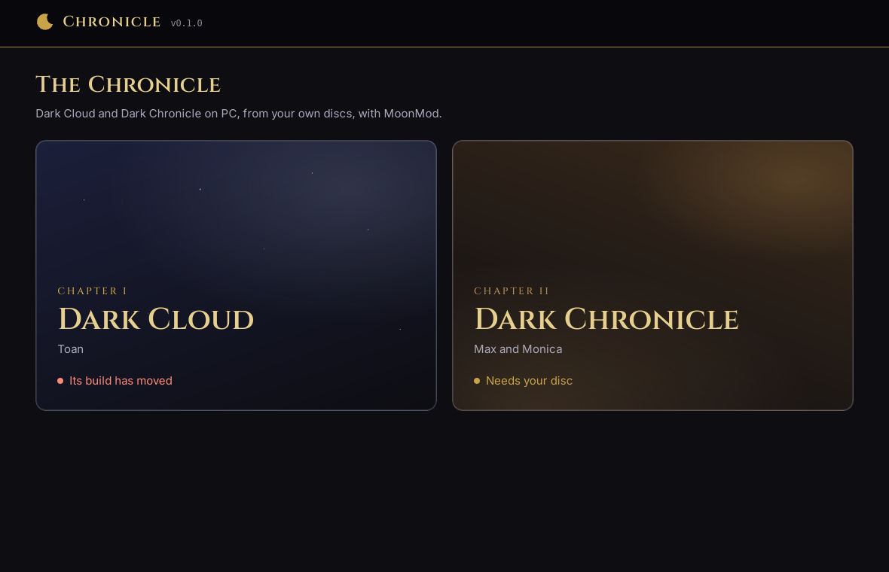
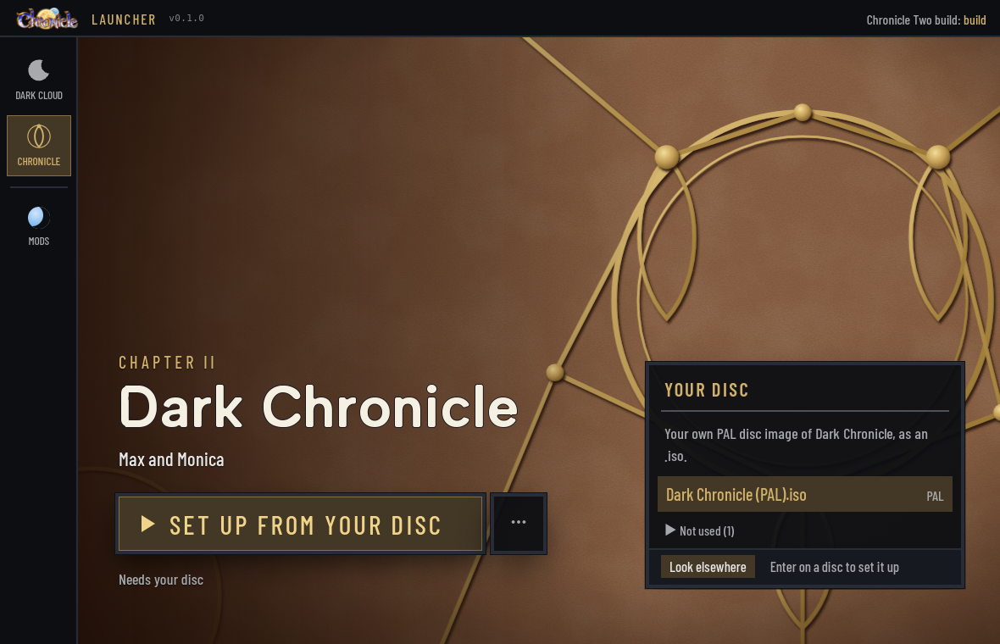
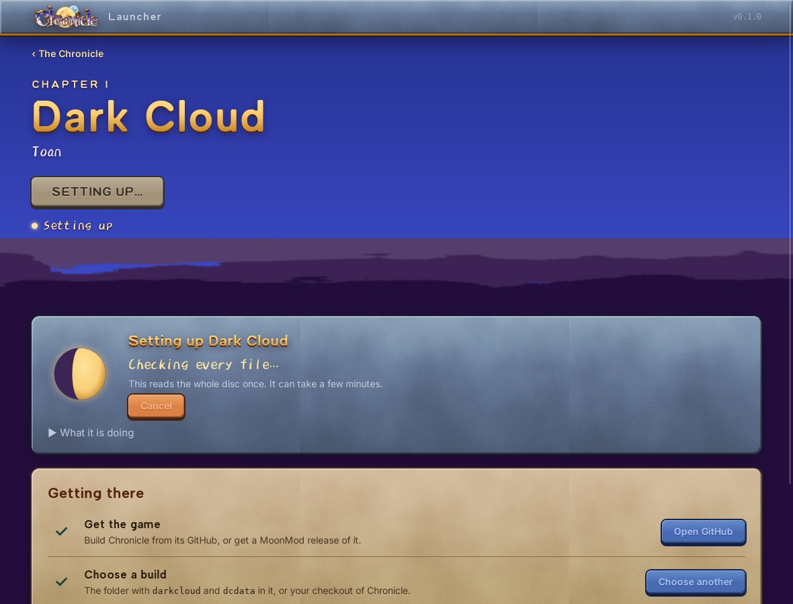

<div align="center">

# Chronicle Launcher

**Dark Cloud and Dark Chronicle on PC, from your own discs, with MoonMod.**

</div>

The launcher for The Moon People's native ports,
[Chronicle](https://github.com/TheMoonPeople/Chronicle) (Dark Cloud) and
[Chronicle Two](https://github.com/TheMoonPeople/ChronicleTwo) (Dark Chronicle), with mods from
[MoonMod](https://github.com/Jeffiest/MoonMod). The two games are the Chronicle's two chapters: pick one, and its
page says the one next step: **Get the game**, **Set up from your disc**, **Play**.

Nothing from the games is included or downloaded. You supply your own disc.

| The Chronicle                                          | A chapter                                                             |
| ------------------------------------------------------ | --------------------------------------------------------------------- |
|  |  |

## Where it stands

Phase 2 of [the plan](docs/PLAN.md), for Dark Cloud:

- **Get the game** opens the port's GitHub (the launcher ships no builds yet); **Choose a build** remembers the
  folder with your build of the port, or your checkout of it.
- **Your disc**: the launcher looks in a folder, two folders down, for an `.iso` of Dark Cloud's PAL release (the
  July 12, 2001 prototype the port is built against), told the way the port's extractor tells it. NTSC discs, and
  releases it does not know, are named and turned away. A `.chd` is pointed out, to be made an image first.
- **Set up from your disc** runs the port's `dcdata extract`, the gold moon waxing as it goes, and can be cancelled.
- **Play** starts `darkcloud` on the launcher's own data and save folders. A crash is kept on the page, with **Copy
  report** and **Save report** (home folder written `~`), until the game next closes cleanly.
- **Saves**: each save's play time and day, read from its `save.dat`; **Back up now**, and restoring a backup (what
  was there is backed up first).

Phase 3, Moon Factory, for Dark Cloud: the game's MoonMod mods, from the same folder the game reads, each with
its switch, its settings (switches, choices, sliders, from its own `mod.json`) and what it is allowed to do in plain
words. Choices go to the same `profile.json` the in-game Mod Manager uses. **Add a mod** takes a `.zip` or a
folder and shows what it is before installing it. The **Mods** switch beside Play is off by default: the game then
starts with `MOONMOD_NO_MODS=1`, which needs MoonMod's `launcher-no-mods` change in the build.

This has been run end to end with stand-ins for `dcdata` and `darkcloud` (`core/tests/flow.rs`, and the app itself
on a virtual display), not yet with a real disc. Dark Chronicle comes in phase 4.



## Building

Tauri 2: Rust does every file and process operation (`core/`, `src-tauri/`), Svelte 5 draws the UI (`src/`).
Linux needs Tauri's libraries (`libwebkit2gtk-4.1-dev libgtk-3-dev librsvg2-dev`).

```sh
npm install
npm run dev          # the UI alone in a browser, on mock data (src/lib/api.ts)
npx tauri dev        # the app
npx tauri build      # an installer
npm run verify       # typecheck, format, UI tests
cargo test --workspace
```

`CHRONICLE_LAUNCHER_HOME=<folder>` keeps the launcher's settings and game folders somewhere other than its usual
data folder.

| Read                                   | For                                       |
| -------------------------------------- | ----------------------------------------- |
| [docs/PLAN.md](docs/PLAN.md)           | what we are building, in what order       |
| [docs/REFERENCE.md](docs/REFERENCE.md) | what we learned from the OpenRAC launcher |
| [games/README.md](games/README.md)     | how a game is described                   |
